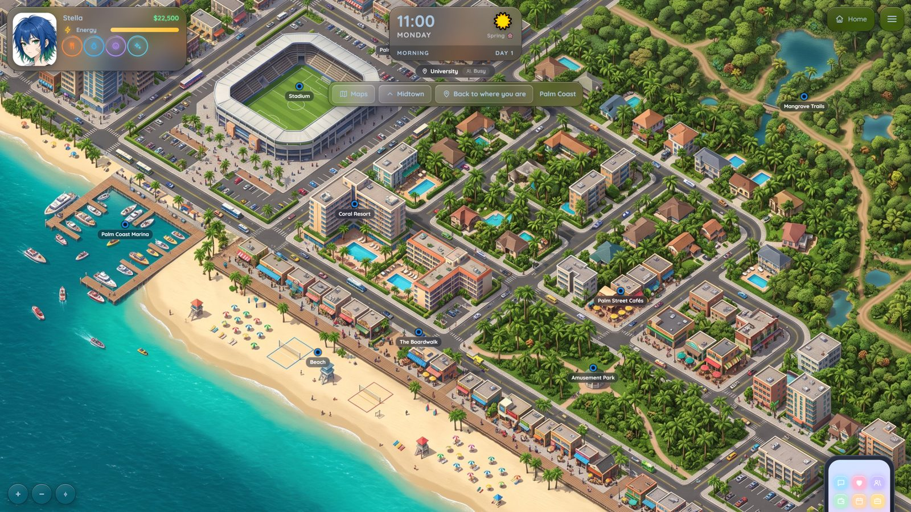
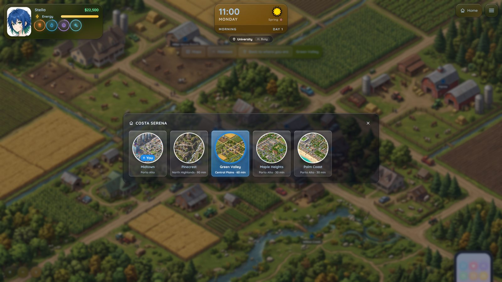
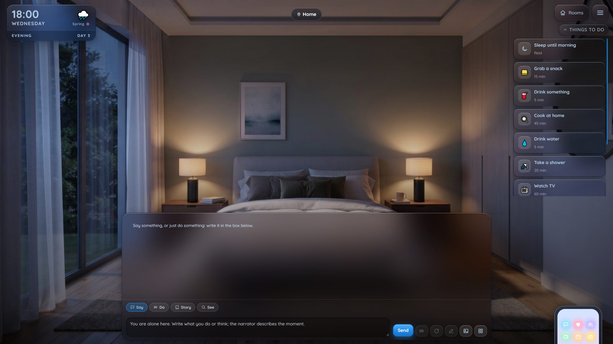
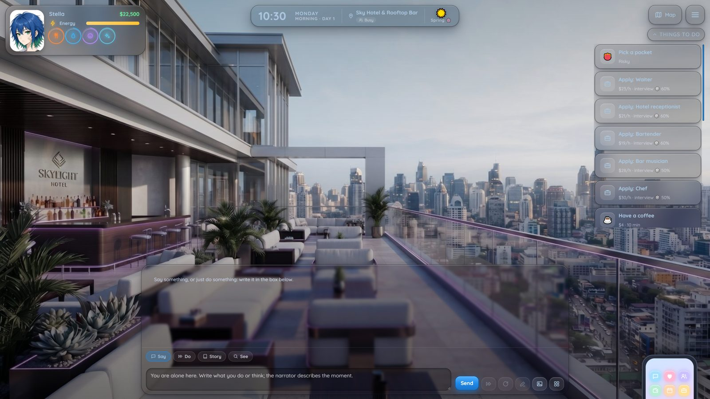
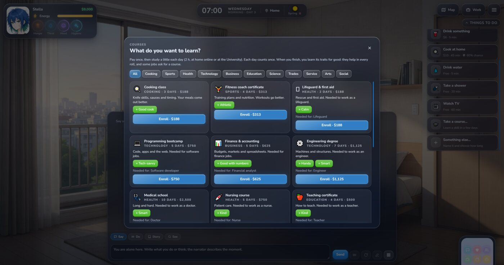
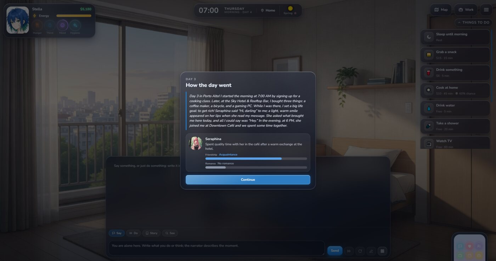
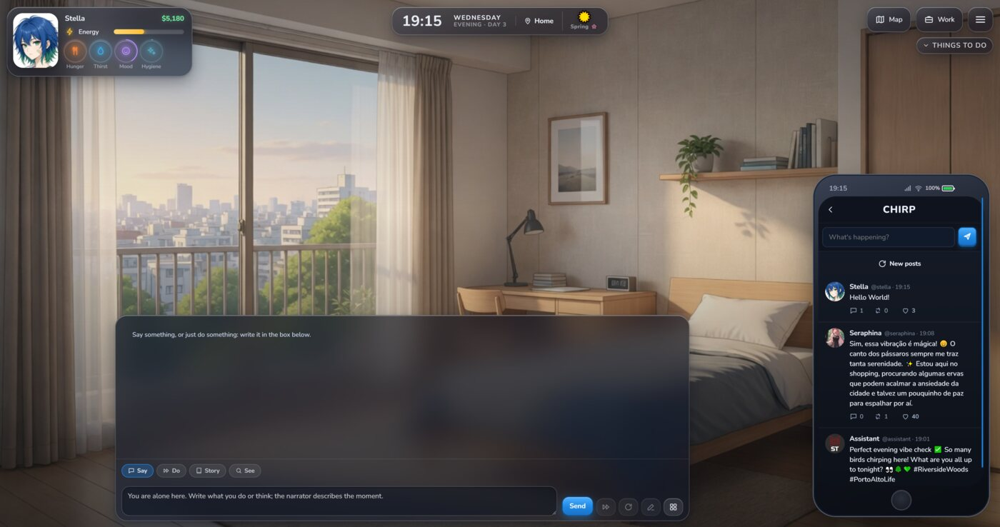
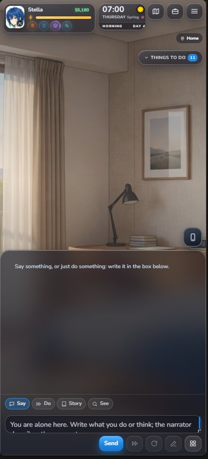

# Mundi

**Open worlds inside SillyTavern.** Mundi turns a SillyTavern group chat into a life you live: a city with a map and a clock, needs to look after, a job, bills, people with their own days, and the story the AI writes around what you do.

<p align="center"></p>

It is a SillyTavern **extension** (no server plugin). Everything is built on what SillyTavern already has: your character cards, personas, lorebooks and group chats. A save *is* a chat.

## What you can do

- **Live in a world.** A map of places, time that moves when you act, weather and seasons. Energy, hunger, thirst, mood and hygiene drop over time.
- **Talk.** A visual-novel scene with Say / Do / Story / See. Type `@` to pick who answers. The engine keeps the numbers (time, money, relationships); the AI writes the scene.
- **Relationships.** Friendship and romance bars with levels, approval, feelings that fade, dates, proposals, marriage, a baby. People keep their own routines: find them, or text them.
- **Work and money.** Job interviews (a d20 roll with your traits as bonus), shifts, promotions, quick gigs, courses that teach traits, weekly rent, water and power that get cut off if you don't pay. Easy / Normal / Hard.
- **A phone.** Messages, People, Jobs, Bank, Homes, Chirp (social), Spark (dating), Calendar, Journal, Shop, Goals, Profile and Help.
- **Households and "Play as".** Live with family or roommates, then switch to playing any of them.
- **A diary.** Each night the day is written as a short entry, so the story remembers what happened.
- **Make it yours.** Layouts (Visual novel, Classic, Cards), colors with transparency, presets that tint the HUD glass, a world creator for your own maps and rules.
- **Phones.** Upright and sideways layouts, with their own scale for the HUD.
- **A tour.** Stella shows you around in a practice world. No AI needed.
- **Home mode.** A more role-play focused way to play: one house, the characters you choose, no work or bills. Pick the rooms, draw a floor plan, go out and come back.
- **In your language.** The interface is in English, Português (Brasil) and Español (Settings → Interface → Language).

It comes with **Porto Alto**, a modern coastal state with five cities (Midtown, Palm Coast, Maple Heights, Pinecrest and Green Valley), and **The Shared House** for Home mode. The medieval style (Valdoria) and the RPG mode are coming in a later update.

See [CHANGELOG.md](CHANGELOG.md) for what changed in each version.

## Screenshots (0.2)

| | | |
|---|---|---|
|  |  |  |
|  |  |  |
|  |  |  |

## Screenshots

| | |
|---|---|
|  |  |
|  |  |
|  |  |

On a phone:

<p align="center">
  
  
  
</p>

## Install

1. In SillyTavern, open **Extensions → Install extension**.
2. Paste `https://github.com/tjalis/Mundi` and install.
3. Reload SillyTavern (Ctrl+F5). Open Mundi from the **Extensions menu** (the magic wand next to the chat box). The tour starts the first time you open it.

Works with SillyTavern 1.19 or newer. Any chat-completion or text-completion API works; a context of about 30k tokens is a good size.


## Building from source

The repository ships the compiled `dist/` and `style.css`, so you don't need to build to use it. To change the code:

```sh
npm i -g typescript
./build.sh        # src/*.ts → dist/, css/*.css → style.css
```

## Credits

- Sounds by [Kenney](https://kenney.nl) (CC0).
- Seraphina is SillyTavern's default character; her picture is bundled for the tour.

## License

[AGPL-3.0](LICENSE), the same license as SillyTavern.
